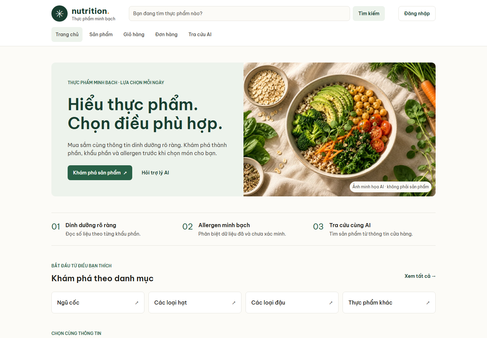
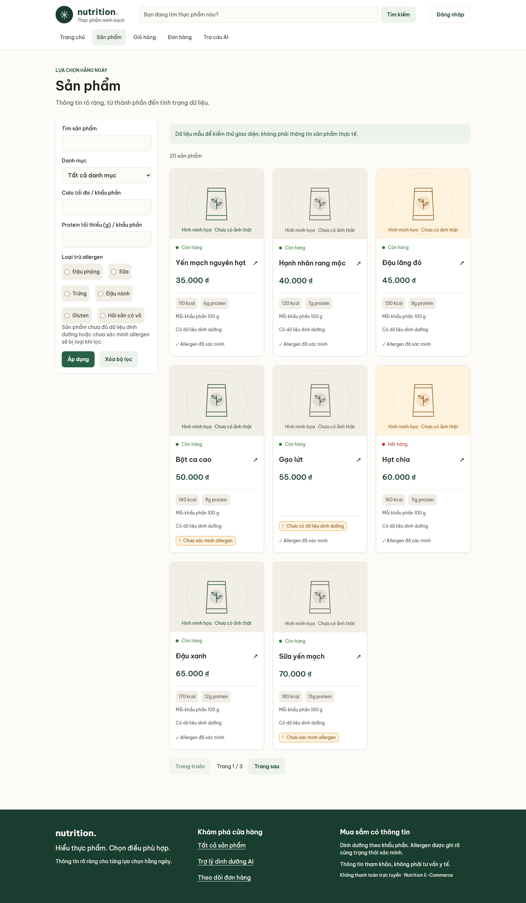
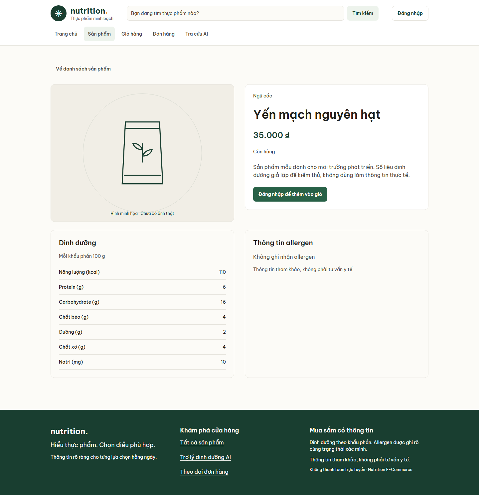
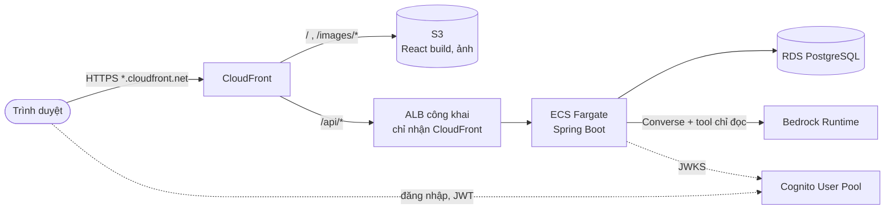

# Nutrition E-Commerce

[](https://github.com/trungnguyen-VNTN/nutrition-ecommerce/actions/workflows/ci.yml)


Ứng dụng thương mại điện tử thực phẩm với chức năng tra cứu dinh dưỡng bằng AI.
Người dùng có thể xem sản phẩm, tìm kiếm không dấu, lọc và sắp xếp theo dinh dưỡng,
quản lý giỏ hàng và đặt hàng. Catalog demo gồm 41 sản phẩm với dinh dưỡng từ USDA
FoodData Central và ảnh thật (CC0 / public domain). Dữ liệu còn thiếu hoặc chưa được
người kiểm tra xác nhận được ghi rõ, không bao giờ hiển thị như "đã xác minh".
Ứng dụng đã chạy trên AWS (CloudFront + ECS Fargate + RDS) và chỉ được bật khi demo (D20).



<details>
<summary>Thêm ảnh: danh sách sản phẩm và chi tiết dinh dưỡng</summary>

| Danh sách và bộ lọc allergen | Chi tiết dinh dưỡng |
| --- | --- |
|  |  |

Ảnh chụp với API và PostgreSQL local. Giá và tồn kho là dữ liệu mẫu; dinh dưỡng từ USDA.

</details>

## Mục lục

- [Phạm vi và công nghệ](#phạm-vi-và-công-nghệ)
- [Kiến trúc](#kiến-trúc)
- [Cấu trúc](#cấu-trúc)
- [Chạy local](#chạy-local)
- [Kiểm tra](#kiểm-tra)
- [Trạng thái dự án](#trạng-thái-dự-án)
- [Đóng góp](#đóng-góp)
- [Làm việc với AI agent](#làm-việc-với-ai-agent)
- [Giấy phép](#giấy-phép)

## Phạm vi và công nghệ

MVP gồm catalog, tài khoản, giỏ hàng, đặt hàng/quản lý đơn, quản trị sản phẩm và
AI tra cứu chỉ đọc. Không có thanh toán hoặc tư vấn y tế. Khi lọc dinh dưỡng hay
allergen, sản phẩm thiếu dữ liệu liên quan bị loại khỏi kết quả.

Chức năng chính:

- **Catalog:** tìm kiếm không phân biệt dấu (`unaccent`), lọc theo danh mục, calo,
  protein, allergen (fail-closed), sắp xếp theo giá / protein / calo (sản phẩm thiếu
  dữ liệu xếp cuối), ảnh sản phẩm, nhãn dinh dưỡng theo khẩu phần.
- **Allergen trung thực:** "Allergen đã xác minh" chỉ hiện khi admin xác nhận;
  dữ liệu mẫu ghi "Allergen theo thành phần (dữ liệu mẫu)" (D25).
- **Tài khoản (Cognito):** đăng ký, xác minh email, đăng nhập, quên mật khẩu.
- **Mua hàng:** giỏ hàng, đặt hàng (trừ kho có điều kiện trong transaction), hủy đơn.
- **Quản trị:** tổng quan thống kê (đơn, doanh thu, tồn kho thấp, chất lượng dữ liệu),
  sản phẩm, dinh dưỡng / allergen, ảnh, danh mục, xử lý đơn.
- **AI tra cứu (Bedrock):** chỉ trích bộ lọc, sản phẩm và số liệu lấy từ DB, có
  Guardrail và quota; đang chờ AWS mở quyền model cho tài khoản.
- **Bảo vệ:** JWT Cognito, giới hạn tốc độ API theo user / IP, CloudFront → ALB có
  header bí mật, cảnh báo CloudWatch qua SNS.

Công nghệ:

- Backend: Java 21, Spring Boot 4.1 (Jackson 3), JDBC, Flyway, PostgreSQL 17.
- Frontend: React 19, TypeScript, Vite, Tailwind, TanStack Query, zod; Vitest và Playwright/axe.
- AWS (`ap-southeast-1`, Terraform): CloudFront, S3, ALB, ECS Fargate ARM64, RDS,
  Cognito, Bedrock + Guardrail, CloudWatch / SNS; deploy bằng GitHub Actions OIDC.

## Kiến trúc

Kiến trúc đã triển khai trên AWS (bật / tắt theo buổi demo, xem `infra/README.md`). ALB công khai đứng sau CloudFront,
chỉ nhận lưu lượng từ CloudFront; chi tiết xem [kiến trúc](docs/architecture.md)
và [quyết định](docs/decisions.md).



Backend chỉ lấy danh tính từ JWT, tool AI chỉ đọc qua SQL tham số hóa, và việc
lọc allergen / dinh dưỡng là fail-closed khi thiếu dữ liệu.

## Cấu trúc

```text
backend/                Spring Boot, Flyway migrations, tests, Maven Wrapper
frontend/               React, Vitest, Playwright/axe, screenshots local
infra/bootstrap/        Bucket lưu Terraform state (state local)
infra/envs/dev/         Root Terraform duy nhất, backend S3 (D19)
infra/modules/          Module: network, ecr, rds, cognito, images, service, frontend,
                        github-oidc, guardrail, alarms
scripts/                Launcher local, bật / tắt AWS (demo-infra.ps1), nhập USDA
.github/                CI, Dependabot, mẫu PR và issue
docs/                   Kiến trúc, quyết định, API, DB, tiến độ
docs/screenshots/       Ảnh dùng trong README
docs/verification/      Bằng chứng kiểm tra lịch sử
START.bat / STOP.bat    Chạy và dừng local trên Windows
docker-compose.yml      PostgreSQL và volume dữ liệu
```

## Chạy local

Cần Java 21, Node.js >=22.12.0, npm và Docker Desktop/Engine đang hoạt động.
Trên Windows, sau khi đã cài dependency frontend, có thể nhấp đúp `START.bat`;
`STOP.bat` dừng các tiến trình do launcher tạo và PostgreSQL, giữ nguyên dữ liệu.
Launcher không cài dependency thay người dùng.

Chạy thủ công trong các terminal riêng:

1. Tại gốc repository, khởi động PostgreSQL:

   ```sh
   docker compose up -d postgres
   docker compose exec postgres pg_isready -U nutrition_dev -d nutrition_dev
   ```

   Chờ thông báo nhận kết nối. Database `nutrition_dev` ở `localhost:5433`;
   compose chỉ bind loopback và dùng trust cho local, không dùng cấu hình này cho production.

2. Tạo DB ứng dụng rồi chạy API với profile `usda` (dinh dưỡng từ USDA FoodData Central):

   ```sh
   docker compose exec postgres createdb -U nutrition_dev nutrition_usda
   cd backend
   ./mvnw spring-boot:run -Dspring-boot.run.profiles=usda
   ```

   Windows PowerShell dùng `./mvnw.cmd spring-boot:run "-Dspring-boot.run.profiles=usda"`.
   Giá và tồn kho là dữ liệu mẫu. USDA không có dữ liệu allergen: allergen của catalog
   demo được suy ra từ thành phần và hiển thị là "dữ liệu mẫu" cho tới khi admin xác nhận (D23, D25).
   Profile `local` với DB `nutrition_dev` chỉ dùng dữ liệu giả cho kiểm thử tích hợp.
   Tạo lại dữ liệu bằng `node scripts/usda-import.mjs` (đọc `USDA_API_KEY`, mặc định `DEMO_KEY`).
   API tại `http://localhost:8080`; health tại `http://localhost:8080/actuator/health`.
   Trên máy ít RAM, đặt `MAVEN_OPTS=-Xmx256m -XX:MaxMetaspaceSize=128m -XX:+UseSerialGC`
   trong môi trường terminal trước khi chạy Maven.

3. Chạy frontend:

   ```sh
   cd frontend
   npm ci
   npm run dev
   ```

   Chỉ cần `npm ci` lần đầu hoặc khi lockfile thay đổi. Mở `http://localhost:5173`.
   Vite chuyển tiếp `/api` tới backend ở cổng 8080; MSW chỉ phục vụ kiểm thử.

### Cấu hình môi trường

`.env.example` ở gốc chỉ ghi chú: compose hiện không nội suy biến môi trường.
`backend/.env.example` liệt kê các biến thực sự được backend dùng. Spring Boot
không tự đọc file `.env`: cung cấp biến qua terminal, IDE hoặc môi trường chạy.
Local mặc định dùng PostgreSQL nêu trên, không cần mật khẩu với compose hiện tại.

Frontend có thể dùng `frontend/.env.local` dựa trên `frontend/.env.example`;
Vite đọc cấu hình khi khởi động/build. Hai ID Cognito là cấu hình công khai,
không phải secret. Không đưa secret vào bất kỳ biến `VITE_*` nào.

Catalog local không cần AWS. Đăng nhập cần Cognito thật và cấu hình khớp giữa
frontend/backend; AI cần model hoặc inference profile Bedrock và quyền runtime.
Không có cơ chế bỏ qua xác thực khi thiếu cấu hình. Không commit file `.env` thật.

Để `START.bat` bật đăng nhập bằng Cognito dev: chép `scripts/local-settings.example.json` thành
`scripts/local-settings.json` (git bỏ qua) và điền `cognito_user_pool_id`, `cognito_app_client_id`
lấy từ `terraform -chdir=infra/envs/dev output`. Launcher đặt các biến `COGNITO_*` cho backend và
`VITE_COGNITO_*` cho frontend từ file này.

## Kiểm tra

Backend (cần PostgreSQL local cho kiểm thử tích hợp):

```sh
cd backend
./mvnw verify
```

Trên Windows dùng `./mvnw.cmd verify`. Frontend:

```sh
cd frontend
npm run format:check
npm run lint
npm run typecheck
npm test -- --maxWorkers=1
npm run build
```

Chuẩn bị Chromium lần đầu rồi chạy E2E/axe hoặc chụp ảnh:

```sh
npm exec -- playwright install chromium
npm run test:e2e
npm run screenshots
```

Dừng dev/preview server đang chiếm cổng 5173/4173 trước khi chạy Playwright;
config kiểm thử tự quản lý server. Ảnh nằm trong `frontend/.screenshots/`, không commit.
Build có kiểm tra production bundle không chứa mock API.

Terraform (bật / tắt và thứ tự apply xem `infra/README.md`; chỉ chạy tới `plan` rồi dừng):

```sh
terraform fmt -check -recursive infra
terraform -chdir=infra/envs/dev init -backend=false
terraform -chdir=infra/envs/dev validate
```

## Trạng thái dự án

Giai đoạn 0–5 và phần lớn giai đoạn 7 đã xong; giai đoạn 6 (AI) đã có code, Guardrail
và bộ đánh giá nhưng đang chờ AWS Support mở quyền gọi model cho tài khoản. Chi tiết
từng đợt xem [tiến độ](docs/PROGRESS.md).

- **Đã kiểm chứng trên AWS** (qua `https://<id>.cloudfront.net`): catalog 41 sản phẩm,
  ảnh từ S3 qua CloudFront, bộ lọc allergen, deploy bằng GitHub Actions. Đăng ký /
  đăng nhập với Cognito thật đã thử khi chạy local. Hạ tầng mặc định tắt; `scripts/demo-infra.ps1 up` / `down` khi demo.
- **Kiểm thử:** backend 44 test (tích hợp với PostgreSQL thật), frontend 104 unit test,
  CI xanh trên GitHub. E2E/axe (Playwright) chưa chạy lại sau đợt rà soát giai đoạn 7
  vì máy phát triển thiếu Chromium.
- **Chưa kiểm chứng trên AWS:** các thay đổi của đợt rà soát giai đoạn 7 (tìm không dấu,
  sắp xếp, quên mật khẩu, thống kê admin, giới hạn tốc độ, Spring Boot 4); làm ở lần bật app tới.
- **Giới hạn đã biết:** chưa có domain nên CloudFront → ALB đi HTTP (O6, đã chấp nhận);
  email Cognito dùng sender mặc định (khoảng 50 email/ngày); giới hạn tốc độ nằm trong
  bộ nhớ của một task; không có thanh toán (D6).
- **Kế hoạch chạy lại bằng chứng:** [diễn tập demo](docs/demo.md), [runbook](docs/runbook.md).

## Đóng góp

- Một tính năng một nhánh một PR vào `master`; đặt tên nhánh `feat/…`, `fix/…`, `chore/…`, `docs/…`.
- Commit theo [Conventional Commits](https://www.conventionalcommits.org/): `feat(scope): …`, `fix: …`, `docs: …`.
- PR dùng [mẫu có sẵn](.github/pull_request_template.md): ghi lệnh kiểm thử đã chạy và
  xác nhận các nguyên tắc bất biến. CI phải xanh trước khi merge.
- Thay đổi hạ tầng chỉ qua Terraform; PR kèm tóm tắt `terraform plan`, không `apply` từ máy cá nhân.
- Định dạng file theo `.editorconfig` và `.gitattributes` (LF, UTF-8, thụt lề 2 dấu cách).
- Không commit `.env`, `*.tfvars`, state Terraform, token hay dữ liệu cá nhân.

## Làm việc với AI agent

- [Quy tắc gốc](AGENTS.md), [backend](backend/AGENTS.md), [frontend](frontend/AGENTS.md).
- [Quyền và cấu hình Codex](.codex/README.md).
- [Quy tắc Claude Code](CLAUDE.md); việc giao diện dùng skill `ui-ux-pro-max` trong `.claude/skills/`.
- [Playbook](docs/playbook.md) và [mẫu prompt](docs/prompts.md).
- [Kiến trúc](docs/architecture.md), [quyết định](docs/decisions.md),
  [hướng dẫn UI](docs/ui-guidelines.md).

## Giấy phép

Phát hành theo [giấy phép MIT](LICENSE).
