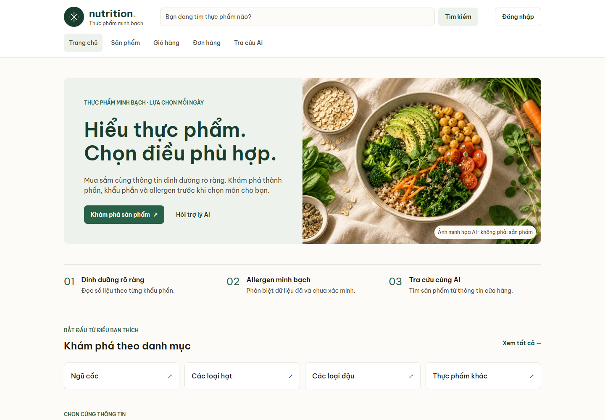
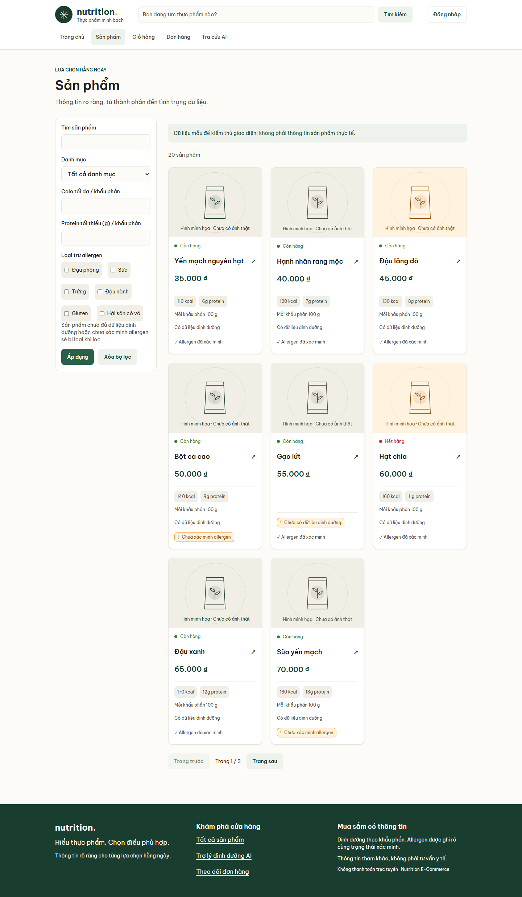
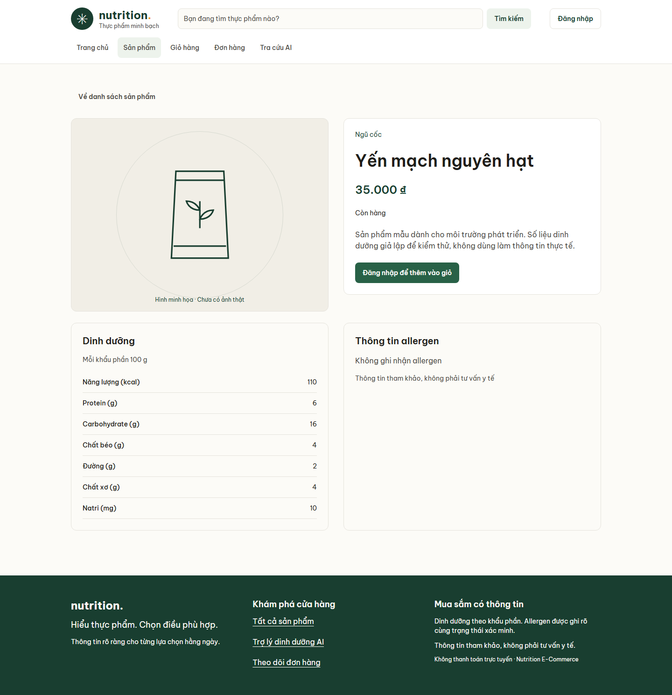
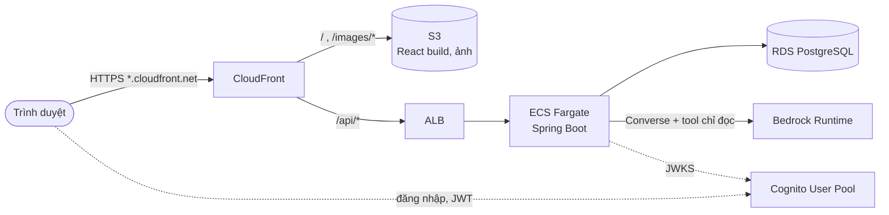

# Nutrition E-Commerce

[](https://github.com/trungnguyen-VNTN/nutrition-ecommerce/actions/workflows/ci.yml)


Ứng dụng thương mại điện tử thực phẩm với chức năng tra cứu dinh dưỡng bằng AI.
Người dùng có thể xem sản phẩm, lọc dinh dưỡng, quản lý giỏ hàng và đặt hàng.
Dữ liệu dinh dưỡng lấy từ database; dữ liệu còn thiếu được hiển thị rõ ràng.
Dự án đang được kiểm chứng trên local; triển khai AWS vẫn đang chờ.



<details>
<summary>Thêm ảnh: danh sách sản phẩm và chi tiết dinh dưỡng</summary>

| Danh sách và bộ lọc allergen | Chi tiết dinh dưỡng |
| --- | --- |
|  |  |

Ảnh chụp với API và PostgreSQL local, dữ liệu seed mẫu (không phải sản phẩm thật).

</details>

## Mục lục

- [Phạm vi và công nghệ](#phạm-vi-và-công-nghệ)
- [Kiến trúc](#kiến-trúc)
- [Cấu trúc](#cấu-trúc)
- [Chạy local](#chạy-local)
- [Kiểm tra](#kiểm-tra)
- [Trạng thái dự án](#trạng-thái-dự-án)
- [Đóng góp](#đóng-góp)
- [Làm việc với AI agent](#làm-việc-với-ai-agent)

## Phạm vi và công nghệ

MVP gồm catalog, tài khoản, giỏ hàng, đặt hàng/quản lý đơn, quản trị sản phẩm và
AI tra cứu chỉ đọc. Không có thanh toán hoặc tư vấn y tế. Khi lọc dinh dưỡng hay
allergen, sản phẩm thiếu dữ liệu liên quan bị loại khỏi kết quả.

- Backend: Java 21, Spring Boot 3.5, JDBC, Flyway, PostgreSQL.
- Frontend: React, TypeScript, Vite, Tailwind; Vitest và Playwright/axe.
- AWS dự kiến: Cognito, Bedrock và hạ tầng Terraform tại `ap-southeast-1`.

## Kiến trúc

Kiến trúc mục tiêu trên AWS (chưa triển khai). Chi tiết mạng, gồm việc ALB
công khai hay internal qua CloudFront VPC origin, xem
[kiến trúc](docs/architecture.md) và [quyết định](docs/decisions.md).



Backend chỉ lấy danh tính từ JWT, tool AI chỉ đọc qua SQL tham số hóa, và việc
lọc allergen / dinh dưỡng là fail-closed khi thiếu dữ liệu.

## Cấu trúc

```text
backend/                Spring Boot, Flyway migrations, tests, Maven Wrapper
frontend/               React, Vitest, Playwright/axe, screenshots local
infra/cognito/          Terraform Cognito hiện tại
infra/envs/, bootstrap/ Chỗ dành cho môi trường và state backend (chưa dùng)
scripts/                Launcher local cho Windows
.github/                CI, Dependabot, mẫu PR và issue
docs/                   Kiến trúc, quyết định, API, DB, tiến độ
docs/screenshots/       Ảnh dùng trong README
docs/verification/      Bằng chứng kiểm tra lịch sử
START.bat / STOP.bat    Chạy và dừng local trên Windows
docker-compose.yml      PostgreSQL và volume dữ liệu
```

## Chạy local

Cần Java 21, Node.js >=22.12.0, npm và Docker Desktop/Engine đang hoạt động.
Trên Windows, sau khi đã cài dependency frontend, có thể nhấp đúp `START.bat`;
`STOP.bat` dừng các tiến trình do launcher tạo và PostgreSQL, giữ nguyên dữ liệu.
Launcher không cài dependency thay người dùng.

Chạy thủ công trong các terminal riêng:

1. Tại gốc repository, khởi động PostgreSQL:

   ```sh
   docker compose up -d postgres
   docker compose exec postgres pg_isready -U nutrition_dev -d nutrition_dev
   ```

   Chờ thông báo nhận kết nối. Database `nutrition_dev` ở `localhost:5433`;
   compose chỉ bind loopback và dùng trust cho local, không dùng cấu hình này cho production.

2. Chạy API với profile local (có dữ liệu seed):

   ```sh
   cd backend
   ./mvnw spring-boot:run -Dspring-boot.run.profiles=local
   ```

   Windows PowerShell dùng `./mvnw.cmd spring-boot:run "-Dspring-boot.run.profiles=local"`.
   API tại `http://localhost:8080`; health tại `http://localhost:8080/actuator/health`.
   Trên máy ít RAM, đặt `MAVEN_OPTS=-Xmx256m -XX:MaxMetaspaceSize=128m -XX:+UseSerialGC`
   trong môi trường terminal trước khi chạy Maven.

3. Chạy frontend:

   ```sh
   cd frontend
   npm ci
   npm run dev
   ```

   Chỉ cần `npm ci` lần đầu hoặc khi lockfile thay đổi. Mở `http://localhost:5173`.
   Vite chuyển tiếp `/api` tới backend ở cổng 8080; MSW chỉ phục vụ kiểm thử.

### Cấu hình môi trường

`.env.example` ở gốc chỉ ghi chú: compose hiện không nội suy biến môi trường.
`backend/.env.example` liệt kê các biến thực sự được backend dùng. Spring Boot
không tự đọc file `.env`: cung cấp biến qua terminal, IDE hoặc môi trường chạy.
Local mặc định dùng PostgreSQL nêu trên, không cần mật khẩu với compose hiện tại.

Frontend có thể dùng `frontend/.env.local` dựa trên `frontend/.env.example`;
Vite đọc cấu hình khi khởi động/build. Hai ID Cognito là cấu hình công khai,
không phải secret. Không đưa secret vào bất kỳ biến `VITE_*` nào.

Catalog local không cần AWS. Đăng nhập cần Cognito thật và cấu hình khớp giữa
frontend/backend; AI cần model hoặc inference profile Bedrock và quyền runtime.
Không có cơ chế bỏ qua xác thực khi thiếu cấu hình. Không commit file `.env` thật.

## Kiểm tra

Backend (cần PostgreSQL local cho kiểm thử tích hợp):

```sh
cd backend
./mvnw verify
```

Trên Windows dùng `./mvnw.cmd verify`. Frontend:

```sh
cd frontend
npm run format:check
npm run lint
npm run typecheck
npm test -- --maxWorkers=1
npm run build
```

Chuẩn bị Chromium lần đầu rồi chạy E2E/axe hoặc chụp ảnh:

```sh
npm exec -- playwright install chromium
npm run test:e2e
npm run screenshots
```

Dừng dev/preview server đang chiếm cổng 5173/4173 trước khi chạy Playwright;
config kiểm thử tự quản lý server. Ảnh nằm trong `frontend/.screenshots/`, không commit.
Build có kiểm tra production bundle không chứa mock API.

Terraform hiện tại (không triển khai tài nguyên):

```sh
terraform fmt -check -recursive infra
terraform -chdir=infra/cognito init -backend=false
terraform -chdir=infra/cognito validate
```

## Trạng thái dự án

Đã có API/UI catalog, bộ lọc, chi tiết, tài khoản, cart/checkout/orders, admin và
AI chỉ đọc; launcher local đã được thử trên Windows. Các đợt kiểm chứng trước
đã chạy unit, E2E/axe, build và smoke với PostgreSQL/API thật; xem
[tiến độ](docs/PROGRESS.md) để phân biệt kết quả từng đợt và lịch sử lỗi.
[Bằng chứng dependency/audit ngày 29/10](docs/verification/frontend-2026-10-29/REVIEW.md)
là kết quả lịch sử, không phải audit mới.

Cognito/Bedrock end-to-end với AWS thật chưa được kiểm chứng. Còn thiếu ảnh sản phẩm
thật/upload S3, workflow deploy/rollback và hạ tầng triển khai đầy đủ.
AWS đang chờ quyết định domain/TLS cho ALB công khai; Docker image build từng bị
chặn bởi lỗi filesystem Docker Desktop. Chưa tuyên bố MVP đã deploy hoặc CI trên
GitHub đã xanh. Đề xuất tách Terraform thành module/môi trường vẫn chờ duyệt.

## Đóng góp

- Một tính năng một nhánh một PR vào `master`; đặt tên nhánh `feat/…`, `fix/…`, `chore/…`, `docs/…`.
- Commit theo [Conventional Commits](https://www.conventionalcommits.org/): `feat(scope): …`, `fix: …`, `docs: …`.
- PR dùng [mẫu có sẵn](.github/pull_request_template.md): ghi lệnh kiểm thử đã chạy và
  xác nhận các nguyên tắc bất biến. CI phải xanh trước khi merge.
- Thay đổi hạ tầng chỉ qua Terraform; PR kèm tóm tắt `terraform plan`, không `apply` từ máy cá nhân.
- Định dạng file theo `.editorconfig` và `.gitattributes` (LF, UTF-8, thụt lề 2 dấu cách).
- Không commit `.env`, `*.tfvars`, state Terraform, token hay dữ liệu cá nhân.

## Làm việc với AI agent

- [Quy tắc gốc](AGENTS.md), [backend](backend/AGENTS.md), [frontend](frontend/AGENTS.md).
- [Quyền và cấu hình Codex](.codex/README.md).
- [Quy tắc Claude Code](CLAUDE.md); việc giao diện dùng skill `ui-ux-pro-max` trong `.claude/skills/`.
- [Playbook](docs/playbook.md) và [mẫu prompt](docs/prompts.md).
- [Kiến trúc](docs/architecture.md), [quyết định](docs/decisions.md),
  [hướng dẫn UI](docs/ui-guidelines.md).
